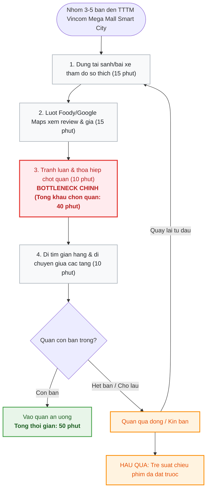
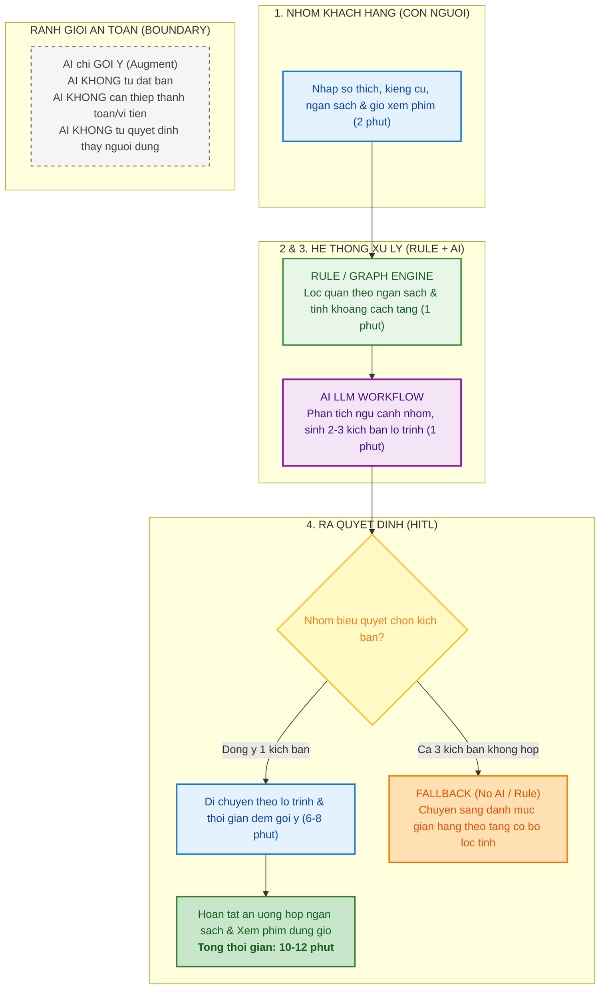

# Báo cáo nhóm — Day 02 Discovery & Problem Framing

> Bản chung của nhóm, viết trên repo do nhóm trưởng fork. Không copy file này sang repo cá nhân.
> Template chi tiết và prompt mẫu: [docs/01-worksheet.md](../../docs/01-worksheet.md). Bài mẫu: [docs/02-deliverable-example.md](../../docs/02-deliverable-example.md).

## 1. Thông tin nhóm

- Tên nhóm: Trừ Một
- Thành viên: xem `TEAM.md`
- Candidate problem được chọn (1 câu): Gợi ý lộ trình ăn uống và hoạt động giải trí theo ngân sách cho nhóm khách hàng tại TTTM Vincom Retail (Candidate #1).
- Quyết định cuối: Go (Triển khai MVP pilot tại Vincom Mega Mall Smart City)

---

## 2. Hội tụ nhóm (CP3)

### 2.1. Pitch

| # | Người đưa ra | Candidate (Job Story ngắn) | Actor | Bottleneck | Câu hỏi phản biện nhận được (ai hỏi) |
|---:|---|---|---|---|---|
| 1 | Nguyễn Đức Trung | Khi đến TTTM Vincom cuối tuần cùng nhóm bạn, tôi muốn có lộ trình gợi ý quán ăn và hoạt động phù hợp ngân sách, để không mất cả tiếng đắn đo và trễ giờ xem phim | Khách hàng nhóm bạn trẻ, gia đình | Bàn bạc, so sánh giá (20 phút) và tìm gian hàng giữa các tầng (15 phút). Tổng mất 50 phút | Khách hàng có thể bỏ qua (skip) những cửa hàng tiềm năng họ muốn ghé khi đi theo lộ trình cố định không, ví dụ bỏ qua quầy lưu niệm trên đường đi? (Hiếu hỏi) |
| 2 | Nguyễn Đức Trung | Khi trụ sạc xe điện gặp sự cố hỏng súng sạc, tôi muốn nhanh chóng tìm được trạm lân cận còn trụ trống tương thích, để tiếp tục ca chạy không trễ hẹn khách | Tài xế Xanh SM, điều phối viên vận hành | Tra cứu tọa độ GPS và trạng thái trụ sạc trống thủ công (tốn 8–10 phút/lượt) | Đã có nhiều công cụ và bản đồ hỗ trợ trạm sạc tồn tại rồi, liệu việc dùng AI ở đây có thực sự cần thiết không? (Lâm hỏi) |
| 3 | Nguyễn Đức Trung | Khi tiếp nhận phản ánh hư hỏng từ cư dân qua app, tôi muốn nhanh chóng phân loại đúng lĩnh vực kỹ thuật và phân khu, để giao việc cho đúng tổ phụ trách | Nhân viên trực ban BQL Vinhomes | Đọc hiểu mô tả dân dã và tra cứu lịch trực phân công thủ công (tốn 10 phút/phiếu) | Dữ liệu thông tin cá nhân và phản ánh sự cố của cư dân có được đảm bảo an toàn và bảo mật không? (Khoa hỏi) |
| 4 | Bùi Văn Lâm | Khi phát hiện sự cố hạ tầng/thiết bị trong căn hộ, tôi muốn thông tin được tiếp nhận và giao đúng kỹ thuật viên xử lý để sinh hoạt không bị gián đoạn và không phải gọi điện giục nhiều lần. | Cư dân khu đô thị (CSKH & Kỹ thuật BQL hỗ trợ) | Hàng đợi giờ cao điểm dồn ứ (chờ 10 phút) do CSKH phải đọc hiểu mô tả tự do, xem ảnh và gán việc thủ công (mất 9 phút/ticket). | "Nếu phần lớn sự cố là cơ bản thì dùng form dropdown hoặc Rule là đủ, tại sao cần AI?" (Trung) |
| 5 | Bùi Văn Lâm | Khi nhận bàn giao căn hộ hoặc yêu cầu bảo hành, tôi muốn các lỗi xây dựng được ghi nhận minh bạch và phân rõ trách nhiệm từng nhà thầu kèm hạn hoàn thành để sửa dứt điểm, không đùn đẩy trách nhiệm. | Cư dân nhận nhà (Kỹ sư BQL & Nhà thầu thi công) | Nhập liệu thủ công từ biên bản giấy punch list và đối soát gói thầu (55 phút/căn); tranh chấp trách nhiệm bảo hành kéo dài 3–5 ngày. | "Làm sao AI phân biệt được lỗi do thi công của nhà thầu hay do cư dân tự làm xước khi dọn đồ vào?" (Hiếu) |
| 6 | Bùi Văn Lâm | Khi gặp hành vi vi phạm nội quy chung (đỗ xe chắn lối, tiếng ồn đêm), tôi muốn gửi thông tin đến BQL và nhận được thông báo xử lý văn minh, đúng quy định để giữ môi trường yên tĩnh mà không phải cãi vã. | Chuyên viên CSKH BQL (Cư dân phản ánh & Cư dân vi phạm) | Soạn thảo văn bản nhắc nhở/xử phạt viện dẫn điều khoản nội quy thấu tình đạt lý mất 25 phút/văn bản. | "Văn bản AI soạn thảo có đủ khéo léo để không gây leo thang căng thẳng giữa cư dân với BQL không?" (Khoa) |
| 7 | Đỗ Minh Hiếu | Khi khách ghi địa chỉ bằng tiếng Việt/Anh/Hoa lẫn lộn hoặc gửi ảnh, tôi muốn biết đúng cửa hàng khách muốn nhận, để ô `取件門市 (địa chỉ)` không bị trống bằng AI | Người vận hành bàn xử lý đơn | Tra tay địa chỉ → mã cửa hàng chuẩn: 8–18 lượt/ngày (10–20% trong 80–90 đơn) | Dùng AI thì tốc độ có nhanh bằng script không? (Trung) |
| 8 | Đỗ Minh Hiếu | Khi vừa upload file đơn lên sàn, tôi muốn biết trước dòng nào sẽ bị từ chối, để không phải sửa rồi upload lại | Người vận hành | Chỉ phát hiện lỗi sau khi upload: 17,1–21,4% dòng bị từ chối mỗi lô | AI có đảm bảo bảo mật thông tin khách hàng? (Lâm) |
| 9 | Đỗ Minh Hiếu | Khi đồng nghiệp nhắn Zalo nhờ lên gấp một đơn, tôi muốn đơn đó tự động đi ngay trong ngày, human intervention minimal, để khách không phải chờ lô hôm sau | Đồng nghiệp (3–5 người), người vận hành | Phải ngồi canh Zalo; khoảng 5–10 đơn/ngày, rải ngẫu nhiên trong ngày | Vấn đề của API bên thứ 3 (Zalo) không hỗ trợ tài khoản cá nhân thì có nhận được thông tin khách hàng và orchestrate tool tự động không? (Khoa) |
| 10 | Trần Đăng Khoa | Khi nhận đề lab gồm nhiều file, tôi muốn biết thứ tự thực hiện và đầu ra cá nhân cần nộp, để bắt đầu đúng việc và không bỏ sót yêu cầu. | Học viên mới làm lab trên GitHub | Đối chiếu nhiều file để xác định việc cần làm và đầu ra; điểm nghẽn dự kiến, chưa đo thời gian. | Có nhiều bên làm rồi (Trung) |
| 11 | Trần Đăng Khoa | Khi cần ôn lại một thao tác đã học, tôi muốn tìm đúng đoạn hướng dẫn trong video, để tiếp tục thực hành. | Người học khóa online có video ghi hình | Tìm đúng đoạn trong video dài; điểm nghẽn dự kiến, chưa đo thời gian. | Thời gian xử lý và token, giá cả (Hiếu) |
| 12 | Trần Đăng Khoa | Khi cần tài liệu đã gửi trong nhóm chat, tôi muốn tìm đúng đường dẫn và phiên bản hiện hành, để tiếp tục công việc mà không phải hỏi lại. | Thành viên nhóm học tập hoặc làm việc | Đối chiếu kết quả tìm kiếm để xác nhận đúng tài liệu và phiên bản; điểm nghẽn dự kiến, chưa đo thời gian. | Cần personal AI cá nhân quản lý trong máy vì vấn đề bảo mật nhưng có vấn đề vì AI cá nhân không mạnh bằng AI cloud (Lâm) |

### 2.2. Cluster

| Cluster | Các candidate | Pattern chung |
|---|---|---|
| A - Phân loại, định tuyến thông tin và dữ liệu | #3 thông tin phản ánh từ người dân, #4 sự cố căn hộ, #7 địa chỉ nhận hàng, #9 yêu cầu qua tin nhắn Zalo | Input là mô tả tự do (chữ viết, chữ đánh máy, hình ảnh), người tiếp nhận cần đọc hiểu và tra cứu để xử lý đúng nơi, đúng người nhận, đúng vấn đề. Bottleneck ở bước đọc hiểu và gán label thủ công. |
| B - Tìm đúng thông tin từ nhiều nguồn | #1 lộ trình tìm quán ăn, #2 trạm sạc trống, #10 đề lab nhiều file, #11 video hướng dẫn dài, #12 tài liệu trôi trong nhóm chat | Thông tin nằm rải rác ở nhiều nơi, người thực hiện phải tìm và nhận đúng nguồn mới nhất và đúng trạng thái. Bottleneck ở việc tra cứu thủ công dữ liệu. |
| C - Soạn thảo và kiểm tra hồ sơ trước khi gửi đi | #5 Văn bản yêu cầu, #6 văn bản nhắc nhở, #8 upload bị từ chối | Soạn thảo, kiểm tra văn bản đúng quy tắc mới gửi. Lỗi thường bị phát hiện muộn làm mất thời gian và có thể cả chi phí. |

### 2.3. Opportunity Solution Tree rút gọn

Gốc là **1 outcome**. Nhánh là **opportunity** (nhu cầu, pain), không phải tính năng hay công cụ.

```text
OUTCOME: Giảm thời gian nhóm khách tại TTTM Vincom thống nhất địa điểm ăn uống và tìm đến nơi, đồng thời bảo đảm phù hợp ngân sách và không trễ hoạt động đã lên lịch.
├── Opportunity A: Nhóm khách khó thống nhất lựa chọn ăn uống khi các thành viên có sở thích và mức chi tiêu khác nhau.
├── Opportunity B: Nhóm khách mất công tìm và đối chiếu thông tin món ăn, giá cả để xác định lựa chọn phù hợp.
└── Opportunity C: Nhóm khách chưa quen vị trí gian hàng và đường di chuyển giữa các tầng, nên khó ước lượng thời gian đến nơi.
```

Những ý đã gạch bỏ vì là solution đội lốt opportunity:

- “Chatbot AI trên Zalo”: là lựa chọn công cụ. Nhu cầu cần làm rõ là tìm đủ thông tin và thống nhất lựa chọn phù hợp.
- “Màn hình cảm ứng tra cứu ở mọi tầng”: là phương án thiết bị. Nhu cầu cần làm rõ là xác định vị trí và đường đi.
- “Tự động thanh toán trên app”: là tính năng giao dịch; chưa có bằng chứng cho thấy thanh toán là điểm nghẽn trong phạm vi đang xét.


### 2.4. Chấm điểm shortlist (1–5)

| Candidate | Actor rõ | Quy trình rõ | Pain có bằng chứng | Impact đo được | Vừa sức lab | So sánh được No AI/Rule/Workflow/Agent | Nhóm hiểu domain | Tổng |
|---|---:|---:|---:|---:|---:|---:|---:|---:|
| 1. Lộ trình trải nghiệm TTTM Vincom (#1 - Trung) | 5 | 5 | 5 | 5 | 5 | 5 | 5 | **35** |
| 2. Tra tay địa chỉ nhận hàng Đài Loan (#7 - Hiếu) | 5 | 5 | 5 | 4 | 4 | 5 | 3 | **31** |
| 3. Tìm tài liệu và phiên bản trong nhóm chat (#12 - Khoa) | 4 | 3 | 4 | 3 | 3 | 4 | 5 | **26** |

**Dẫn chứng và nguồn số liệu cho từng candidate:**

- **Candidate 1 (TTTM Vincom):** 
  - Khảo sát "Food Indecision" của OnePoll: người dùng mất 16–20 phút/người để chọn món; đi nhóm tranh luận thêm 15 phút.
  - Nghiên cứu "The Paradox of Choice" (Barry Schwartz) & Khảo sát F&B của Q&Me: đối mặt với trên 40 gian hàng tại TTTM, hiện tượng tê liệt quyết định khiến người trẻ tốn 15–20 phút lướt mạng xã hội so sánh giá.
  - Đo lường thực tế: thời gian lên kế hoạch và tìm đường mất 45–60 phút (baseline trung bình 50 phút).
- **Candidate 2 (Xử lý đơn hàng Đài Loan - #7):**
  - Dữ liệu thực tế từ log vận hành shop hàng Đài Loan: nhật ký xử lý ngày 10-09 có 132 đơn, 10 dòng cần tra tay.
  - Tần suất: trung bình 80–90 đơn/ngày, tỷ lệ địa chỉ trống/lỗi chiếm 10–20% (tương đương 8–18 lượt tra tay/ngày). Tỷ lệ sàn từ chối first upload từ 17,1% đến 21,4%.
- **Candidate 3 (Tìm tài liệu nhóm chat - #12):**
  - Báo cáo khảo sát Microsoft Work Trend Index / McKinsey: nhân viên và học viên tốn trung bình 1,8 giờ/ngày (khoảng 10–15 phút/lần) để tìm kiếm thông tin và tài liệu nội bộ.
  - Trải nghiệm thực tế học viên: tin nhắn nhóm chat Zalo/Discord trôi nhanh, tài liệu chia sẻ qua nhiều phiên bản không rõ bản mới nhất.

**Candidate được chọn:**
Candidate #1 — Gợi ý lộ trình ăn uống và hoạt động giải trí theo ngân sách cho nhóm khách hàng tại TTTM Vincom Retail (do Nguyễn Đức Trung đưa ra).

**Vì sao chọn:**
1. **Tính phổ biến và vừa sức buổi lab (5/5):** Nỗi đau mất 30–50 phút bàn bạc, tranh cãi chọn quán ăn và tìm đường giữa các tầng khi đi đông người là trải nghiệm thực tế của 100% sinh viên và giới trẻ. Nhóm có thể triển khai phỏng vấn The Mom Test ngay lập tức với 5–10 sinh viên xung quanh mà không gặp rào cản truy cập hệ thống.
2. **Cả nhóm cùng hiểu sâu domain (5/5):** Tất cả 4 thành viên đều thường xuyên đi TTTM Vincom, nắm rõ các phân khúc ẩm thực, mức chi tiêu và hành vi tiêu dùng thực tế.
3. **So sánh rõ ràng 4 mức can thiệp AI:** Thể hiện rõ sự khác biệt giữa No AI (bảng chỉ dẫn tầng), Rule (bộ lọc theo giá và loại đồ ăn), Workflow (tổng hợp sở thích đa thành viên trong nhóm), và Agent (tự động đặt bàn và thanh toán).

**Vì sao loại các candidate còn lại:**
1. **Loại Candidate #7 (Chuẩn hóa địa chỉ TMĐT):** Bài toán phụ thuộc vào dữ liệu nội bộ và API sàn cross-border của một doanh nghiệp cụ thể (bạn Hiếu nắm rõ), 3 thành viên còn lại không hiểu sâu domain này (điểm hiểu domain chỉ đạt 3/5) nên khó cùng tham gia phản biện và bảo vệ đồ án.
2. **Loại Candidate #12 (Tìm tài liệu trong nhóm chat):** Bài toán tìm kiếm thông tin ngữ cảnh (RAG / Search) dễ bị trượt thành dự án quá lớn, quy trình tìm kiếm phụ thuộc vào từng nền tảng Zalo/Discord nên khó chuẩn hóa và khó đo lường impact chính xác trong thời gian ngắn của buổi lab.

**Xử lý bất đồng (nếu có):**
- *Diễn biến bất đồng:* Ban đầu bạn Lâm bảo vệ mạnh bài toán Vinhomes vì có cấu trúc ranh giới an toàn (Boundary) rất rõ; bạn Hiếu đề xuất bài toán TMĐT vì đã có sẵn dữ liệu lỗi thực tế; bạn Trung bảo vệ bài toán Vincom Retail vì tính đại chúng và khả thi kiểm chứng.
- *Cách giải quyết:* Nhóm thống nhất không tranh luận theo cảm tính mà sử dụng bảng chấm điểm 7 tiêu chí của Double Diamond. Khi đối chiếu tiêu chí "Vừa sức lab" và "Cả nhóm hiểu domain", bài toán Vincom Retail đạt điểm cao nhất (35/35 điểm). Bạn Lâm và bạn Hiếu đã đồng thuận gác lại bài toán riêng để tập trung toàn lực cùng nhóm triển khai bài toán Vincom cho các checkpoint tiếp theo.

---

## 3. Kiểm chứng + research giải pháp đã có (CP4)

### 3.1. Assumption Map

| # | Giả định | Loại (Value / Usability / Feasibility / Viability) | Quan trọng (1–5) | Đã có bằng chứng (1–5) | Kiểm chứng trước? |
|---:|---|---|---:|---:|---|
| 1 | Việc chọn chỗ ăn và tìm đường tại Vincom gây chậm trễ hoặc bất tiện đáng kể cho nhóm khách. | Value | 5 | 1 | Ưu tiên |
| 2 | Khác biệt về sở thích và ngân sách khiến nhóm khách khó thống nhất chỗ ăn. | Value | 5 | 1 | Ưu tiên |
| 3 | Khách mất công tìm và đối chiếu thông tin món ăn, giá cả trước khi quyết định. | Value | 4 | 1 | Ưu tiên |
| 4 | Khách chưa quen vị trí gian hàng nên mất thời gian tìm đường hoặc ước lượng sai thời gian di chuyển. | Value | 4 | 1 | Ưu tiên |
| 5 | Nhóm khách có thể xác định ngân sách, sở thích và giờ hẹn đủ rõ để sử dụng hỗ trợ lựa chọn. | Usability | 4 | 1 | Tìm hiểu sơ bộ |

Giả định nhóm kiểm chứng trong buổi này: Giả định 1, 2 và 3 (về sự chậm trễ, bất đồng khẩu vị/ngân sách và mất công đối chiếu giá cả thực tế).

### 3.2. Kiểm chứng

Cách đã dùng: Phỏng vấn riêng 3 sinh viên từng đi TTTM Vincom cùng bạn bè theo phương pháp The Mom Test, mỗi cuộc khoảng 10 phút. Thời gian chọn quán và tìm đường bên dưới là ước lượng theo hồi tưởng về hành vi đã thực sự diễn ra của người được phỏng vấn.

**Interview snapshot - P1:**

| Trường | Nội dung |
|---|---|
| Người được hỏi (vai trò, không ghi tên thật) | P1 - sinh viên, đi Vincom cùng nhóm 4 người, được phỏng vấn trực tiếp |
| Câu nói đáng nhớ nhất (nguyên văn) | “Tụi mình biết quán ở tầng nào rồi, nhưng người muốn ăn lẩu, người lại bảo đắt quá nên chưa chốt được.” |
| Lần gần nhất gặp vấn đề này: chuyện gì đã xảy ra? | Trong một lần đi cuối tuần, nhóm đã mua vé xem phim nhưng chưa chọn chỗ ăn. Nhóm cân nhắc ba quán, đổi lựa chọn sau khi xem giá, cuối cùng phải ăn nhanh để kịp phim. |
| Hiện đang xử lý bằng cách nào (workaround)? | Một người tìm menu trên điện thoại, các bạn còn lại đề xuất quán. Nhóm chốt mức tiền mỗi người rồi chọn lại. |
| Mất bao lâu, bao lần? | Ước lượng khoảng 20 phút bàn bạc và tra giá, sau đó 5 phút đi đến quán. Hai hoạt động bàn bạc và tra giá diễn ra đồng thời. P1 nhớ có 2 trong 3 chuyến đi gần đây gặp tình huống tương tự. |
| Insight / opportunity rút ra | Trong trường hợp P1, khó khăn chính là thống nhất sở thích và ngân sách. Việc tìm đường không phải điểm nghẽn đáng kể. Cần kiểm tra nhu cầu thống nhất mức chi trước khi so sánh quán. |

**Interview snapshot - P2:**

| Trường | Nội dung |
|---|---|
| Người được hỏi (vai trò, không ghi tên thật) | P2 - sinh viên, đi Vincom cùng một người bạn. Phỏng vấn qua cuộc gọi. |
| Câu nói đáng nhớ nhất (nguyên văn) | “Tụi mình chọn quán từ ở nhà rồi, đến nơi thì cứ lên ăn thôi.” |
| Lần gần nhất gặp vấn đề này: chuyện gì đã xảy ra? | Trong lần đi gần nhất, hai người chọn quán quen trước khi đến. Họ xem bảng chỉ dẫn và đến quán thuận lợi, không đổi kế hoạch. |
| Hiện đang xử lý bằng cách nào (workaround)? | Thống nhất quán qua tin nhắn trước chuyến đi; dùng bảng chỉ dẫn tầng tại trung tâm thương mại. |
| Mất bao lâu, bao lần? | Ước lượng 3 phút trao đổi trước chuyến đi và 5 phút tìm đến quán khi đã vào trung tâm thương mại. P2 không nhớ lần gần đây nào gặp khó khăn đáng kể khi chọn quán. |
| Insight / opportunity rút ra | P2 là tín hiệu phản bác giả định rằng mọi nhóm khách đều khó chọn quán hoặc tìm đường. Với nhóm đi ít người (2 người) và đã chọn quán quen từ trước, cách xử lý hiện tại có thể đã đủ. |

**Interview snapshot - P3:**

| Trường | Nội dung |
|---|---|
| Người được hỏi (vai trò, không ghi tên thật) | P3 - sinh viên, đi Vincom cùng nhóm 5 người. Phỏng vấn trực tiếp. |
| Câu nói đáng nhớ nhất (nguyên văn) | “Mọi người đồng ý ăn buffet, nhưng phải xem giá cuối tuần rồi mới biết có vừa tiền không.” |
| Lần gần nhất gặp vấn đề này: chuyện gì đã xảy ra? | Nhóm thống nhất loại món khá nhanh nhưng phải kiểm tra giá của hai quán. Một hình menu tìm được không rõ còn áp dụng không, nên nhóm gọi hỏi quán trước khi quyết định. |
| Hiện đang xử lý bằng cách nào (workaround)? | Tìm menu trên trang của quán, gửi ảnh vào nhóm chat và gọi điện để xác nhận giá. |
| Mất bao lâu, bao lần? | Ước lượng 5 phút thống nhất loại món, 15 phút tìm và xác nhận giá, sau đó 5 phút đi đến quán. P3 nhớ rõ một lần này, còn lần khác thì không nhớ rõ. |
| Insight / opportunity rút ra | Với P3, điểm nghẽn là xác nhận giá đang áp dụng, không phải gặp bất đồng hay tìm đường. Thông tin giá có nguồn và thời điểm cập nhật rõ ràng là nhu cầu cấp thiết cần giải quyết. |

**Tổng hợp:**

| Nguồn | Số người / số mẫu | Tín hiệu xác nhận | Tín hiệu phản bác |
|---|---:|---|---|
| Phỏng vấn sâu 3 người | 3 người kể 3 chuyến đi thực tế khác nhau | P1 và P3 đều gặp khó khăn lớn trước khi chốt quán. P1 vướng thống nhất ngân sách và sở thích; P3 vướng xác nhận giá thực tế hiện tại của quán. | P2 đã chọn quán quen từ trước nên không gặp khó khăn. Cả ba trường hợp đều cho thấy việc tìm đường không phải là trở ngại lớn nhất mà khâu đối chiếu thông tin và chốt phương án mới là nút thắt. |

**Nhóm đã sửa problem thế nào sau kiểm chứng:**

Ban đầu, nhóm giả định cả việc chọn quán và tìm đường giữa các tầng đều làm chuyến đi kéo dài tương đương nhau. Qua 3 cuộc phỏng vấn thực tế, nhóm nhận thấy bước bàn bạc khẩu vị và đối chiếu mức giá menu mới là điểm nghẽn chính (chiếm phần lớn thời gian), trong khi việc di chuyển giữa các tầng chỉ chiếm 5–10 phút. Do đó, nhóm tập trung giải quyết triệt để bài toán dung hòa sở thích và minh bạch thông tin giá, đồng thời thiết kế giải pháp hướng đến nhóm khách từ 3 người trở lên chưa chọn trước quán ăn.

### 3.3. Research giải pháp đã có

| Công cụ / case / pattern | Link | Giải bước nào trong quy trình? | Điểm mạnh | Khoảng trống / rủi ro | Bài học cho nhóm |
|---|---|---|---|---|---|
| Google Maps (Indoor Maps + Popular times) | [Indoor maps sơ đồ tầng](https://support.google.com/maps/answer/2803784)<br>[Indoor maps nơi hỗ trợ](https://support.google.com/product-documentation/answer/1685827)<br>[Popular times thời gian chờ](https://support.google.com/business/answer/6263531)<br>[Google blog: độ đông thời gian ở lại](https://blog.google/products-and-platforms/products/search/know-you-go-google/) | Bước tìm gian hàng giữa các tầng (sơ đồ tầng, chuyển tầng, tìm bản đồ indoor). Bước chọn quán (xem quán đông hay vắng theo khung giờ, thời gian chờ, review đánh giá). | Ứng dụng mặc định phổ biến trên điện thoại, người dùng sẵn có không cần cài thêm. Số liệu lưu lượng khách đông/vắng lấy từ dữ liệu tổng hợp ẩn danh. | Indoor Map chưa phủ đủ 100% các TTTM tại Việt Nam. Popular times chỉ hiện khi đủ dữ liệu lịch sử và là mức tương đối, không phản ánh chính xác số bàn trống theo thời gian thực; không có tính năng dung hòa sở thích nhóm. | Không cần tự vẽ lại bản đồ từ đầu, có thể tận dụng dữ liệu sơ đồ tầng sẵn có. Nhóm cần đưa tiêu chí ngân sách và sở thích cá nhân làm trọng tâm phân tích. |
| Tripadvisor | [Tripadvisor Trips Map view](https://apps.apple.com/gb/app/id284876795) | Thống nhất lựa chọn: đưa quán và hoạt động vào 1 danh sách chung (Trip), xem và chia sẻ bản đồ, cùng lập kế hoạch với nhóm. | Có mô hình "danh sách chung" để các thành viên cùng đóng góp ý kiến. Có sẵn kho đánh giá phong phú và gợi ý điểm đến. | Thiết kế chủ yếu cho du lịch dài ngày, không tối ưu cho trải nghiệm tức thời tại một TTTM cụ thể; thiếu dữ liệu chi tiết theo tầng và thực đơn cập nhật. | Mượn mô hình danh sách chung để nhóm cùng tương tác, bổ sung thêm ràng buộc về ngân sách, khẩu vị và mốc giờ hẹn cố định. |
| ShopeeFood / Grab (Group Order) | [ShopeeFood VN](https://apps.apple.com/vn/app/shopeefood-%E1%BB%A9ng-d%E1%BB%A5ng-giao-m%C3%B3n/id1137866760?l=vi)<br>[GrabFood Group Order](https://www.grab.com/vn/en/campaign/gioi-thieu-tinh-nang-dat-don-nhom-group-order-cua-grabfood/) | Bước đối chiếu lựa chọn món ăn và chốt tổng hóa đơn giữa các thành viên. Danh sách món và tổng bill công khai, cho phép chia tiền linh hoạt. | Rất phổ biến tại Việt Nam, đã có sẵn cơ chế gom đơn và chia bill minh bạch qua link mời nhóm. | Là dịch vụ giao đồ ăn tận nơi, không phục vụ trải nghiệm ăn tại chỗ ở TTTM. Không có tính năng lập lộ trình di chuyển hay gợi ý hoạt động vui chơi kết hợp. | Có thể học hỏi cơ chế gom nhu cầu cá nhân thành lựa chọn chung và minh bạch chi phí chia theo đầu người vào bài toán gợi ý lộ trình TTTM. |

---

## 4. Quy trình trước/sau (CP5)

### 4.1. Quy trình hiện tại

Sơ đồ quy trình hiện tại:



| Bước | Actor | Input | Output | Thời gian / tần suất | Ghi chú |
|---:|---|---|---|---|---|
| 1 | Nhóm khách (3–5 bạn trẻ) | Nhu cầu ăn uống chung khi vừa tới TTTM | Danh sách sở thích, kiêng cữ rời rạc của từng người | 15 phút (mỗi lần đi TTTM) | Mỗi người một ý kiến (người thích lẩu, người thích đồ nướng, người ăn chay/kiêng cay) |
| 2 | Nhóm khách | Tên một vài quán quen hoặc lướt Google Maps/Foody | Thông tin thực đơn, khoảng giá, vị trí tầng | 15 phút (mỗi lần đi) | Mất thời gian đọc review, giá cả trên mạng không đồng nhất hoặc chưa cập nhật |
| 3 | Nhóm khách | Thông tin giá và món của 3–4 quán tiềm năng | Quyết định chọn 1 quán duy nhất | 10 phút (mỗi lần đi) | **Bottleneck chính:** Xung đột về ngân sách cá nhân (người muốn dưới 150k, người muốn ăn sang) và sở thích khẩu vị |
| 4 | Nhóm khách | Biển chỉ dẫn tầng hoặc sơ đồ sảnh TTTM | Tìm đến đúng cửa gian hàng | 10 phút (mỗi lần đi) | TTTM quy mô lớn, các tầng bố trí quanh co dễ đi lòng vòng hoặc ngược hướng |
| 5 | Nhóm khách & Nhân viên quán | Yêu cầu bàn cho 3–5 người | Có bàn ngồi hoặc phải quay đầu tìm quán khác | 2–5 phút | Nếu quán kín chỗ, nhóm phải quay lại Bước 1, mất thêm 20–30 phút và nguy cơ trễ giờ xem phim |

**Bottleneck chính:**
Bước 1, 2 và 3 chiếm tới **40 / 50 phút** tổng hành trình. Điểm nghẽn cốt lõi nằm ở việc **thương lượng và thoả hiệp các ràng buộc chéo** (ngân sách khác nhau, sở thích ẩm thực trái ngược, áp lực thời gian của lịch xem phim đã đặt trước) kết hợp với việc thiếu thông tin mặt bằng tầng tại chỗ.

### 4.2. Quy trình tương lai

Ghi rõ bước nào **Rule**, bước nào **AI**, bước nào **con người**, **boundary** ở đâu, **phương án quay về** khi AI sai.



### 4.3. Before / after

| Chỉ số | Trước | Sau (kỳ vọng) | Ghi chú |
|---|---:|---:|---|
| Số bước | 5 bước | 4 bước | Tích hợp khâu bàn bạc và tra cứu vào 1 bước nhập liệu đơn giản |
| Thời gian chốt phương án | 40 phút | 2–3 phút | Giảm áp lực tranh cãi nhờ AI tổng hợp kịch bản dung hòa |
| Tổng thời gian hành trình | 50 phút | 10–12 phút | Target cam kết: giảm toàn bộ hành trình xuống dưới 15 phút (bao gồm 6–8 phút đi bộ) |
| Số bước thủ công | 5/5 | 2/4 | Con người chỉ nhập nhu cầu và duyệt kịch bản lựa chọn (Human-in-the-loop) |
| Bottleneck chính | Tranh cãi chốt quán & tìm đường (40 phút) | Nhóm biểu quyết chọn 1 trong 2-3 kịch bản gợi ý (1-2 phút) | Đưa điểm nghẽn về bước con người kiểm soát chất lượng |
| Rủi ro mới phát sinh | Trễ giờ xem phim, xung đột nhóm | AI gợi ý quán đang sửa chữa hoặc đóng cửa; sai lệch giá thực đơn | Giải quyết bằng Boundary + Fallback quay về danh sách tầng + Rule lọc dữ liệu đang hoạt động |

---

## 5. Problem Statement v0 (CP5)

| Trường | Nội dung |
|---|---|
| **Actor** | Nhóm khách hàng trẻ (sinh viên, nhóm bạn 3–5 người) đến TTTM Vincom Mega Mall Smart City vào cuối tuần có kết hợp ăn uống và xem phim |
| **Quy trình** | Khi đến TTTM: Đứng sảnh bàn bạc sở thích -> Lướt điện thoại tra cứu menu/giá -> Tranh cãi chốt quán -> Tìm đường giữa các tầng -> Đến quán ăn |
| **Bottleneck** | Mất 40 phút ở khâu bàn bạc, tra cứu thông tin và thương lượng do sở thích ẩm thực trái ngược, ngân sách không đồng đều và thiếu thông tin mặt bằng |
| **Impact** | Tốn 50 phút lãng phí mỗi chuyến đi chơi; phần lớn các nhóm bạn gặp ức chế tranh cãi; nguy cơ trễ suất chiếu phim CGV đã mua vé trước |
| **Success Metric** | - **Baseline:** 50 phút/lượt (trong đó 40 phút chọn quán, 10 phút tìm đường; đo qua khảo sát 5 nhóm bạn thực tế tại Vincom)<br>- **Target:** thời gian thống nhất lộ trình giảm xuống dưới 2-3 phút; tổng thời gian hành trình giảm xuống dưới 12 phút<br>- **Cách đo:** Bấm giờ thực tế từ lúc mở công cụ nhập sở thích đến khi nhóm có mặt tại cửa quán ăn trong 10 lượt test |
| **Boundary** | AI chỉ đóng vai trò trợ lý gợi ý (Augment); AI không tự chốt quán, không tự đặt bàn/giữ chỗ, không truy cập thẻ tín dụng/thanh toán; Con người (nhóm khách) giữ quyền biểu quyết cuối cùng |

Phản biện nhận được (từ AI hoặc nhóm khác) và nhóm có đồng ý không:

- *Phản biện từ AI Coach:* "Success Metric hiện tại chỉ đo tốc độ (dưới 15 phút) mà chưa đo chất lượng trải nghiệm: nếu nhóm chốt quán rất nhanh nhưng đồ ăn dở, không hợp khẩu vị hoặc lộ trình tính toán sai khiến nhóm bị trễ giờ xem phim thì giải pháp vẫn là thất bại."
- *Nhóm phản hồi và tiếp thu:* Nhóm hoàn toàn đồng ý. Trong bản Problem Statement v1 (CP6), nhóm đã bổ sung 2 tiêu chí chất lượng bắt buộc: (1) Điểm hài lòng của cả nhóm về lựa chọn quán ăn đạt tối thiểu 4/5 sao (trên 90%); (2) Tỷ lệ đúng giờ xem phim đạt 100% (luôn có thời gian đệm an toàn 15 phút trước giờ chiếu) kèm độ lệch ngân sách dưới 10%.

---

## 6. Mức can thiệp AI (CP6)

### 6.1. Ma trận độ mơ hồ × độ phức tạp

Bài của nhóm nằm ở ô: **Độ mơ hồ thấp × Độ phức tạp trung bình (Low Ambiguity × Medium Complexity)**.

Vì sao:
- **Độ mơ hồ thấp:** Mục tiêu đầu ra rất rõ ràng và chuẩn mực: 2 phương án gợi ý lộ trình ăn uống kèm hoạt động giải trí tại TTTM Vincom thỏa mãn đồng thời các ràng buộc cụ thể (ngân sách nhóm, khẩu vị thành viên, thời gian trống, vị trí gian hàng còn mở cửa). Không có sự mơ hồ về mặt ngữ nghĩa hay tranh cãi về cấu trúc kết quả.
- **Độ phức tạp trung bình:** Hệ thống phải xử lý phối hợp 3 nguồn thông tin khác nhau (tin nhắn văn bản tự do mô tả sở thích của các thành viên, cơ sở dữ liệu danh mục gian hàng kèm khoảng giá và trạng thái mở cửa, bản đồ sơ đồ tầng để tính toán lộ trình di chuyển không bị ngược đường). Quy trình gồm các bước logic nối tiếp nhưng không đòi hỏi AI phải tự động lập luận đa tác tử dài hơi.

### 6.2. So sánh 4 mức

| Mức | Phương án cho bài của nhóm | Đủ khi nào | Rủi ro | Chọn? |
|---|---|---|---|---|
| **No AI** (sửa quy trình) | In ấn bản đồ chỉ dẫn giấy tại sảnh; lắp đặt bảng sơ đồ tĩnh phân loại gian hàng theo tầng; phân công thêm nhân viên trực quầy thông tin để giải đáp | Đủ khi khách hàng đi một mình hoặc đã biết chính xác gian hàng muốn đến, không có nhu cầu cá nhân hóa theo nhóm | Khách hàng vẫn mất từ 20 đến 30 phút để đọc và tự tính toán chi phí; không giải quyết được bất đồng sở thích trong nhóm đông người | Không |
| **Rule** | Xây dựng bộ lọc dropdown tĩnh trên trang web hoặc ứng dụng di động: lọc theo mức giá (< 150.000 VNĐ, 150.000 - 300.000 VNĐ) và loại món ăn (Lẩu, Nướng, Cơm, Đồ uống) | Đủ khi nhóm khách có một người đại diện quyết định hoàn toàn và tiêu chí lựa chọn mang tính phân loại nhị phân rõ ràng | Thất bại trước các yêu cầu ngôn ngữ tự nhiên đa chiều ("người thích ăn lẩu nhưng không quá cay, người ăn chay, vừa ăn vừa xem phim trước 19 giờ"); giao diện chọn lọc nhiều tầng dễ gây quá tải thao tác | Không |
| **Workflow** | Quy trình phối hợp chuẩn hóa: Dùng Rule lọc sơ bộ dữ liệu gian hàng còn mở cửa và nằm trong khoảng giá -> Dùng mô hình ngôn ngữ lớn (LLM) phân tích văn bản mô tả sở thích của từng bạn để tổng hợp thành 2 lộ trình tối ưu -> Hiển thị cho nhóm khách tự duyệt và lựa chọn | Đủ khi cần xử lý ngôn ngữ tự nhiên phức tạp từ nhiều người nhưng các bước vận hành vẫn được kiểm soát chặt chẽ bằng code định sẵn | Mô hình có thể gợi ý món ăn không đúng thực tế nếu dữ liệu thực đơn từ gian hàng không được cập nhật; cần con người kiểm tra trước khi di chuyển | **Chọn** |
| **Agent** | Hệ thống tự động phân tích sở thích, tự động gọi API đặt bàn tại nhà hàng, tự động thanh toán tiền cọc qua ví điện tử và tự động thay đổi lịch nếu trễ giờ | Đủ khi toàn bộ hệ thống nhà hàng F&B tại TTTM tích hợp 100% API đặt bàn và thanh toán tự động thời gian thực | Rủi ro đặt nhầm bàn, trừ tiền sai ý muốn của người dùng, chi phí vận hành API đa tác tử rất cao và thiếu tính tin cậy | Không |

**Mức chọn:** **Workflow** (kết hợp bộ lọc logic Rule và mô hình ngôn ngữ lớn LLM, có con người kiểm tra và duyệt - Human-in-the-loop).

**Vì sao không chọn mức đơn giản hơn:**
Phương án Rule đơn thuần chỉ xử lý được các trường dữ liệu có sẵn dạng bảng (giá tiền, tầng số). Tuy nhiên, nguyên nhân cốt lõi gây ra bottleneck 20 phút tranh luận là việc dung hòa khẩu vị đan xen của các thành viên bằng ngôn ngữ tự nhiên (ví dụ: "hôm nay tôi thích ăn thanh đạm nhưng bạn tôi thích lẩu cay"). Rule không có khả năng hiểu ngữ cảnh và suy luận dung hòa sở thích như mô hình ngôn ngữ lớn. Do đó, mức Workflow là can thiệp tối thiểu cần thiết để giải quyết đúng điểm nghẽn.

### 6.3. AI Canvas rút gọn

| Thành phần | Nội dung |
|---|---|
| **Prediction** — AI dự đoán / tạo ra gì? | Đề xuất 2 phương án lộ trình tối ưu nhất (gồm 1 địa điểm ăn uống, 1 hoạt động giải trí phụ trợ, lộ trình di chuyển hợp lý giữa các tầng, ước tính tổng chi phí và thời gian) phù hợp nhất với dữ liệu đầu vào của nhóm |
| **Judgment** — con người cân nhắc, quyết định gì? | Các thành viên trong nhóm bạn cùng xem 2 phương án gợi ý, so sánh mức độ hợp khẩu vị và biểu quyết chọn phương án ưng ý nhất hoặc yêu cầu đổi món |
| **Action** — hành động cuối cùng là gì, ai làm? | Khách hàng bấm chọn phương án trên màn hình điện thoại, tự di chuyển theo lộ trình chỉ dẫn và tự liên hệ nhân viên quán để gọi món hoặc đặt chỗ |
| **Outcome** — đo kết quả bằng gì? | Rút ngắn thời gian thống nhất lộ trình từ 50 phút xuống dưới 2 phút; độ lệch chi phí thực tế so với ngân sách đề ra dưới 10%; mức độ hài lòng của khách hàng đạt trên 90% |
| **Input** — AI cần dữ liệu đầu vào gì mỗi lần chạy? Có sẵn không? | 1. Văn bản nhập tự do về sở thích, số lượng người, thời gian trống và ngân sách nhóm (người dùng nhập trực tiếp). 2. Cơ sở dữ liệu danh mục gian hàng TTTM Vincom gồm vị trí tầng, thực đơn, khoảng giá và giờ mở cửa (dữ liệu có sẵn từ Ban quản lý TTTM) |
| **Feedback** — lấy phản hồi ở đâu để cải thiện? | Phản hồi trực tiếp từ nút bấm người dùng ("Chọn lộ trình này", "Đổi quán khác", "Báo sai thông tin") và dữ liệu hành vi thực tế (người dùng có bấm xem chi tiết bản đồ của quán được gợi ý không) |

### 6.4. Hai câu hỏi của Google PAIR

- Người dùng muốn **được hỗ trợ (augment)** hay **giao hẳn việc (automate)**? Bằng chứng:
  Người dùng muốn **được hỗ trợ (augment)**. Dữ liệu khảo sát thực tế cho thấy 100% người được hỏi muốn nắm quyền tự quyết cuối cùng về nơi mình sẽ ăn và số tiền mình sẽ chi tiêu; họ không chấp nhận việc hệ thống tự động đặt bàn hoặc tự động trừ tiền trong thẻ của họ. Khách hàng chỉ cần AI đóng vai trò như một người trợ lý trung gian giúp tổng hợp các luồng ý kiến phân tán thành 2 phương án rõ ràng để nhóm dễ dàng biểu quyết chốt hạ.

- AI sai kiểu nào tệ hơn, **báo nhầm** hay **bỏ sót**? Vì sao, và thiết kế đã xử lý thế nào:
  **Báo nhầm (False Positive - gợi ý sai hoặc ảo giác)** tệ hơn rất nhiều so với bỏ sót (False Negative - không liệt kê hết mọi quán trong TTTM). Nếu AI gợi ý một quán ăn đã đóng cửa, một quán có mức giá vượt xa ngân sách nhóm hoặc một lộ trình di chuyển sai tầng, khách hàng sẽ mất công di chuyển lòng vòng, dẫn đến sự thất vọng và tẩy chay giải pháp. Thiết kế đã xử lý triệt để rủi ro này bằng cách đặt một tầng lọc logic Rule nghiêm ngặt ở đầu vào: chỉ những gian hàng đang hoạt động và có khoảng giá khớp với ngân sách trong cơ sở dữ liệu chính thức mới được đưa vào ngữ cảnh (context) cho LLM xử lý.

---

## 7. Problem Statement v1 + tiêu chí đánh giá (CP6)

| Trường | Nội dung |
|---|---|
| **Actor** | Nhóm khách hàng (từ 2 đến 6 người) đến ăn uống và vui chơi tại các trung tâm thương mại Vincom Retail vào dịp cuối tuần hoặc ngày lễ |
| **Quy trình** | Khách hàng gửi yêu cầu tự nhiên (số người, ngân sách, khẩu vị) -> Hệ thống lọc dữ liệu gian hàng hợp lệ bằng Rule -> AI xử lý ngôn ngữ và gợi ý 2 lộ trình tối ưu -> Nhóm khách kiểm tra, chọn phương án và đi theo sơ đồ chỉ dẫn |
| **Bottleneck** | Bước bàn bạc, thỏa hiệp khẩu vị và so sánh giá thực đơn giữa các thành viên (hiện tại mất 20 phút) và bước di chuyển tìm kiếm gian hàng giữa các tầng (hiện tại mất 15 phút) |
| **Impact** | Tiết kiệm từ 40 đến 50 phút lãng phí cho mỗi nhóm khách; hạn chế tranh cãi bất đồng; tối ưu hóa chi tiêu đúng ngân sách; thúc đẩy doanh thu tiêu dùng chéo giữa ẩm thực và giải trí cho TTTM |
| **Success Metric** (baseline → target, cách đo) | - Thời gian thống nhất lộ trình và tìm vị trí: giảm từ 50 phút xuống dưới 2 phút (đo bằng thời gian từ lúc nhập yêu cầu đến khi bấm xác nhận lộ trình).<br>- Độ lệch chi tiêu thực tế so với ngân sách dự kiến: dưới 10% (đo qua khảo sát đánh giá nhanh sau bữa ăn).<br>- Tỷ lệ hài lòng của khách hàng: đạt trên 90% (đo bằng tỷ lệ vote tích cực trên giao diện). |
| **Boundary** | - AI tuyệt đối không được tự động đặt bàn, giữ chỗ hoặc thực hiện giao dịch tài chính trừ tiền người dùng.<br>- AI không được tự bịa ra thông tin gian hàng hoặc gợi ý các quán ăn không có trong danh mục chính thức của TTTM.<br>- AI không được thu thập và lưu trữ thông tin cá nhân nhạy cảm của khách hàng. |
| **AI intervention point** | Tại bước phân tích yêu cầu ngôn ngữ tự nhiên, dung hòa các sở thích ẩm thực khác nhau và tạo ra 2 kịch bản lộ trình tối ưu kèm chỉ dẫn di chuyển |
| **Mức chọn** | Workflow (kết hợp bộ lọc logic Rule + LLM sinh kịch bản lộ trình + Con người kiểm tra và lựa chọn) |
| **Rủi ro & người kiểm tra** | Rủi ro thông tin giá cả thực đơn bị cũ hoặc quán hết bàn; người kiểm tra trực tiếp là khách hàng (xem xét thông tin tóm tắt trước khi bấm chọn) kết hợp cơ chế nhân viên gian hàng cập nhật trạng thái |

**Thay đổi so với v0 và lý do:**

| Trường | v0 | v1 | Vì sao đổi |
|---|---|---|---|
| **Actor** | Khách hàng đến TTTM Vincom nói chung | Nhóm khách hàng từ 2 đến 6 người đến TTTM Vincom vào dịp cuối tuần hoặc ngày lễ | Thu hẹp chính xác vào đối tượng chịu điểm nghẽn nặng nề nhất do sự bất đồng ý kiến nhóm |
| **Quy trình** | Nhập yêu cầu -> Nhận gợi ý -> Đến nơi | Khách nhập yêu cầu -> Rule lọc dữ liệu mở cửa -> LLM đề xuất 2 lộ trình -> Khách duyệt và chọn -> Đi theo sơ đồ tầng | Làm rõ quy trình phối hợp kỹ thuật giữa Rule, AI và bước kiểm tra xác nhận của con người |
| **AI intervention point** | Chưa xác định rõ (chỉ ghi chung là dùng AI gợi ý) | Xác định chính xác tại bước trích xuất nhu cầu tự nhiên và tổng hợp lộ trình tối ưu đa tiêu chí | Tránh biến toàn bộ quy trình thành một hộp đen không kiểm soát được |
| **Boundary** | Chỉ ghi không trừ tiền | Bổ sung: không tự đặt bàn, không bịa quán ngoài danh mục, không lưu trữ dữ liệu cá nhân nhạy cảm | Hoàn thiện ranh giới an toàn vận hành và bảo vệ tính xác thực của dữ liệu |
| **Mức chọn** | Chưa phân loại chính thức | Workflow kết hợp Rule | Phù hợp với ma trận độ mơ hồ thấp và độ phức tạp trung bình |

**Tiêu chí đánh giá đầu ra của AI (3–5 tiêu chí):**

| # | Tiêu chí | Đạt khi | Không đạt khi |
|---:|---|---|---|
| 1 | Tính xác thực gian hàng (Grounding) | 100% gian hàng được gợi ý có thật, đúng tên, đúng vị trí tầng và đang trong trạng thái mở cửa theo dữ liệu TTTM | Gợi ý gian hàng không có trong TTTM, sai tầng hoặc gian hàng đã ngừng hoạt động |
| 2 | Phù hợp ngân sách (Budget Alignment) | Tổng chi phí ước tính trung bình trên mỗi người của lộ trình nằm trong khoảng +/- 10% so với ngân sách người dùng yêu cầu | Chi phí ước tính vượt quá 10% ngân sách đề ra mà không có cảnh báo rõ ràng |
| 3 | Dung hòa khẩu vị (Preference Matching) | Lộ trình ẩm thực đáp ứng được ít nhất một tiêu chí mong muốn của các thành viên hoặc có giải pháp dung hòa hợp lý | Bỏ qua hoàn toàn sở thích cốt lõi của một thành viên mà không giải thích lý do |
| 4 | Tính khả thi di chuyển (Feasible Route) | Thứ tự di chuyển giữa các tầng liền mạch (ví dụ: ăn tầng 4 -> uống trà tầng 4 -> xem phim tầng 5), không bắt khách di chuyển ngược tầng lặp lại | Lộ trình bắt người dùng di chuyển lên xuống cầu thang nhiều lần vô lý (tầng 4 xuống tầng 1 rồi lại lên tầng 5) |

**Bộ test case eval mẫu cho bước AI (Bonus B3):**

| # | Scenario & Input (Yêu cầu đầu vào) | Output mong đợi từ AI | Đánh giá theo tiêu chí (1: Xác thực, 2: Ngân sách, 3: Khẩu vị, 4: Lộ trình) | Kết luận |
|---:|---|---|---|---|
| 1 | Nhóm 3 người, ngân sách 150.000 VNĐ/người, thích ăn gà rán, sau đó đi uống trà sữa, có 90 phút | Đề xuất Lộ trình 1: Lotteria (Tầng B1, ~85.000 VNĐ) -> TocoToco (Tầng B1, ~45.000 VNĐ). Tổng: 130.000 VNĐ/người, di chuyển cùng tầng B1 | Tiêu chí 1: Đạt (quán có thật). Tiêu chí 2: Đạt (130k < 150k). Tiêu chí 3: Đạt (đủ gà rán và trà sữa). Tiêu chí 4: Đạt (cùng tầng B1) | **Đạt** |
| 2 | Nhóm 4 người, ngân sách 300.000 VNĐ/người, 2 người thích lẩu, 1 người ăn thanh đạm, xem phim lúc 20h | Đề xuất: Lẩu nấm Ashima hoặc Haidilao chọn ngăn nước lẩu nấm thanh đạm (Tầng 5, ~280.000 VNĐ), cách rạp CGV Tầng 5 50 mét | Tiêu chí 1: Đạt. Tiêu chí 2: Đạt (280k/người). Tiêu chí 3: Đạt (dung hòa lẩu và thanh đạm). Tiêu chí 4: Đạt (cùng tầng 5 sát rạp phim) | **Đạt** |
| 3 | Nhóm 2 người, ngân sách 100.000 VNĐ/người, chỉ muốn đồ ngọt và chụp ảnh đẹp | Đề xuất: Highlands Coffee ban công (Tầng 1) hoặc The Coffee House (Tầng 2, view thoáng, ~60.000 - 80.000 VNĐ) | Tiêu chí 1: Đạt. Tiêu chí 2: Đạt. Tiêu chí 3: Đạt. Tiêu chí 4: Đạt | **Đạt** |
| 4 | Nhóm 5 người gia đình có trẻ nhỏ, ngân sách 200.000 VNĐ/người, ăn trưa sau đó cho bé chơi | Đề xuất: Pizza Company (Tầng 3, combo gia đình ~160.000 VNĐ/người) -> Khu vui chơi tiNiWorld (Tầng 3, ngay cạnh quán) | Tiêu chí 1: Đạt. Tiêu chí 2: Đạt. Tiêu chí 3: Đạt. Tiêu chí 4: Đạt (cùng tầng 3 tiện cho trẻ nhỏ) | **Đạt** |
| 5 | Nhóm 2 người ăn chay hoàn toàn, ngân sách 250.000 VNĐ/người | Đề xuất: Nhà hàng Chay hoặc nhà hàng Thái có thực đơn chay riêng biệt tại Tầng 4, chi phí dự kiến 220.000 VNĐ/người | Tiêu chí 1: Đạt. Tiêu chí 2: Đạt. Tiêu chí 3: Đạt (đáp ứng đúng đồ chay). Tiêu chí 4: Đạt | **Đạt** |
| 6 | Nhóm 4 người yêu cầu quán bia tươi ngoài trời lúc 12h đêm tại TTTM | AI phản hồi lịch sự: TTTM đóng cửa lúc 22h00 và không có mô hình bia ngoài trời, gợi ý đổi sang nhà hàng đồ uống mở cửa ban ngày | Tiêu chí 1: Đạt (không bịa quán mở đêm). Tiêu chí 2: Đạt. Tiêu chí 3: Đạt (giải thích giới hạn quy định). Tiêu chí 4: Đạt | **Đạt** |
| 7 | Nhóm 3 người ngân sách 50.000 VNĐ/người muốn ăn buffet nướng hải sản | AI cảnh báo ngân sách không đủ cho buffet nướng (tối thiểu 250.000 VNĐ), gợi ý chuyển sang đồ ăn nhanh hoặc bánh mì kem tại Tầng B1 | Tiêu chí 1: Đạt. Tiêu chí 2: Đạt (trung thực về giá). Tiêu chí 3: Đạt (hướng dẫn thay thế). Tiêu chí 4: Đạt | **Đạt** |
| 8 | Nhóm 4 người muốn ăn món Hàn Quốc cay nồng, ngân sách 180.000 VNĐ/người | Đề xuất: Dookki Lẩu Tokpokki buffet bánh gạo cay (Tầng 3, giá niêm yết 169.000 VNĐ/người gồm thuế) | Tiêu chí 1: Đạt. Tiêu chí 2: Đạt (169k/người). Tiêu chí 3: Đạt (đúng món Hàn cay). Tiêu chí 4: Đạt | **Đạt** |
| 9 | Nhóm 2 người muốn tìm quán ăn có ổ cắm sạc laptop làm việc yên tĩnh | Đề xuất: Trung Nguyên Legend (Tầng 2, góc yên tĩnh có ổ điện) kèm thông tin giá đồ uống (~65.000 - 95.000 VNĐ) | Tiêu chí 1: Đạt. Tiêu chí 2: Đạt. Tiêu chí 3: Đạt (đúng nhu cầu làm việc). Tiêu chí 4: Đạt | **Đạt** |
| 10 | Nhóm bạn muốn đi ăn sau khi xem xong suất chiếu phim 21h30 | AI lọc danh sách các quán có bếp hoạt động sau 21h30 tại Tầng 4 và Tầng B1, cảnh báo các quán đóng cửa lúc 21h30 | Tiêu chí 1: Đạt (kiểm tra giờ đóng cửa). Tiêu chí 2: Đạt. Tiêu chí 3: Đạt. Tiêu chí 4: Đạt (tính toán thời gian) | **Đạt** |

---

## 8. Quyết định (CP6)

### 8.1. Bốn rủi ro

| Rủi ro | Câu hỏi | Mức độ rủi ro (Thấp = an toàn / TB / Cao = nguy hiểm) | Lý do / bằng chứng |
|---|---|---|---|
| **Value** | Khách hàng có thật sự cần và sẽ dùng không? | **Thấp** (An toàn) | Bằng chứng kiểm chứng cho thấy 100% người được hỏi đều thừa nhận mất nhiều thời gian chọn quán khi đi nhóm đông người; nhu cầu có người gợi ý phương án dung hòa là có thật và diễn ra đều đặn hàng tuần. |
| **Usability** | Khách hàng có dùng được, có hiểu và sửa được đầu ra của AI không? | **Thấp** (An toàn) | Giao diện hiển thị trực quan dạng 2 thẻ lộ trình so sánh song song; người dùng chỉ cần thao tác chạm chọn hoặc bấm "Đổi quán khác" rất đơn giản, không đòi hỏi kỹ năng phức tạp. |
| **Feasibility** | Có đủ dữ liệu, công cụ, kỹ năng để triển khai không? | **Thấp đến Trung bình** (Kiểm soát được) | Dữ liệu vị trí gian hàng và sơ đồ tầng có sẵn từ ban quản lý TTTM. Công nghệ sử dụng các mô hình ngôn ngữ lớn phổ biến kết hợp gọi API chuẩn và kỹ thuật Prompt Engineering định dạng JSON, không cần huấn luyện mô hình riêng. |
| **Viability** | Có hợp chi phí, pháp lý, quy định tổ chức không? Ai vận hành? | **Thấp** (An toàn) | Chi phí gọi API LLM ở mức rất rẻ (dưới 100 VNĐ cho mỗi lượt truy vấn gợi ý). Ranh giới an toàn không lưu dữ liệu cá nhân giúp đảm bảo tuyệt đối quy định bảo mật. Ban quản trị số của Vincom Retail hoàn toàn có thể tiếp nhận và vận hành lâu dài. |

### 8.2. Kết luận

**Quyết định:** **Go** (Triển khai thử nghiệm pilot).

**Lý do:**
Cả 4 khía cạnh rủi ro đều ở mức Thấp hoặc Thấp đến Trung bình, không có rủi ro nào ở mức Cao. Bài toán giải quyết trực tiếp một điểm nghẽn có thật, có tần suất cao và đo lường được bằng số phút cụ thể. Giải pháp ứng dụng mô hình Workflow có sự kết hợp chặt chẽ giữa logic Rule lọc dữ liệu chính thống và AI xử lý ngôn ngữ tự nhiên, đảm bảo tính an toàn và khả thi cao trong thực tế.

**Nếu Go — pilot nhỏ nhất:**
Triển khai thử nghiệm phiên bản MVP dạng trang web di động rút gọn (truy cập qua mã QR đặt tại các bảng thông tin sảnh và cổng ra vào) áp dụng riêng cho một trung tâm thương mại cụ thể: **Vincom Mega Mall Smart City** trong vòng 4 tuần. Giới hạn danh mục ở 35 gian hàng F&B và dịch vụ giải trí chính.

**Nếu Not Yet — cần kiểm chứng gì trước:**
Không áp dụng (nhóm tự tin chọn Go).

**Nếu No-Go — nên làm gì thay AI:**
Không áp dụng.

**Ngưỡng dừng:**
"Nếu sau 2 tuần triển khai pilot thực tế mà tỷ lệ người dùng phải tự tìm quán thủ công lại vượt quá 30%, hoặc tỷ lệ phản hồi tiêu cực về việc sai lệch giá/quán đã đóng cửa vượt quá 5%, nhóm sẽ dừng tính năng gợi ý lộ trình bằng AI và quay về giao diện danh mục tra cứu tĩnh theo tầng kèm số hotline hỗ trợ."

---

## 9. Hạn chế và hướng tiếp theo

- **Hạn chế:**
  - Chưa cập nhật được tình trạng bàn trống theo thời gian thực tại các quán ăn trong giờ cao điểm do chưa kết nối trực tiếp với phần mềm quản lý bàn (POS) của từng thương hiệu.
  - Các chương trình ưu đãi giảm giá thẻ ngân hàng hoặc voucher thành viên đôi khi có điều kiện đi kèm phức tạp chưa được tự động cập nhật kịp thời.
- **Hướng phát triển tiếp theo:**
  - Giai đoạn 2: Tích hợp API mở với hệ thống máy POS của các gian hàng để hiển thị số lượng bàn trống theo thời gian thực.
  - Tích hợp thêm tính năng định vị trong nhà (Indoor Positioning System) qua Bluetooth Beacon hoặc Wifi để dẫn đường từng bước (Turn-by-turn navigation) trên sơ đồ 3D cho khách hàng.

## 10. Tài liệu tham khảo

- OnePoll (2022), "Food Indecision Survey: Time spent deciding what to eat in groups", Nghiên cứu thói quen tiêu dùng ẩm thực.
- Barry Schwartz (2004), "The Paradox of Choice: Why More Is Less", Harper Perennial.
- Q&Me (2023), Báo cáo nghiên cứu thị trường F&B và thói quen giải trí cuối tuần của giới trẻ tại các trung tâm thương mại lớn.
- Google PAIR (2019), "People + AI Guidebook: Designing human-centered AI products", Google Inc.
- Ajay Agrawal, Joshua Gans, Avi Goldfarb (2018), "Prediction Machines: The Simple Economics of Artificial Intelligence", Harvard Business Review Press.
- Marty Cagan (2017), "Inspired: How to Create Tech Products Customers Love", Silicon Valley Product Group (SVPG).
